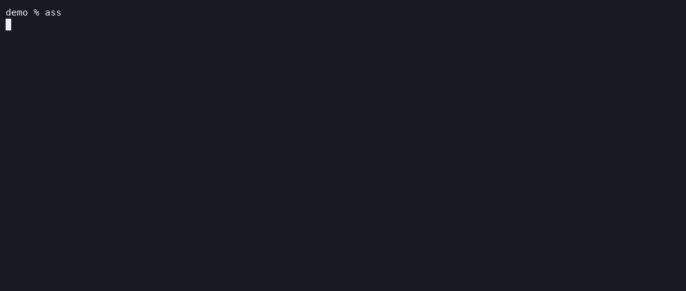

# ass

Agent Session Search (cli). Search conversations across coding agents and pick one to continue.



Runs on macOS and Linux.

Install prerequisites with `brew install go fzf` on macOS, or your package manager on Linux:
```zsh
go install github.com/melkikh/ass@latest

# add to `~/.zshrc` (use your `GOBIN` if customized):
export PATH="$(go env GOPATH)/bin:$PATH"
eval "$(command ass --zsh)"
```

Try `ass` → type `login !test` in fzf (find `login`, exclude `test`) → `↑`/`↓` → `Enter` → choose an agent → `Enter`.

| Chat source | Codex app | Codex CLI | Claude CLI | OpenCode CLI |
|---|---|---|---|---|
| Codex | ✓ | ✓ | — | — |
| Claude | ✓ | ✓ | ✓ | — |
| Cursor | ✓ | ✓ | — | — |
| OpenCode | ✓ | ✓ | — | ✓ |

Opening a chat in a different agent imports it.
